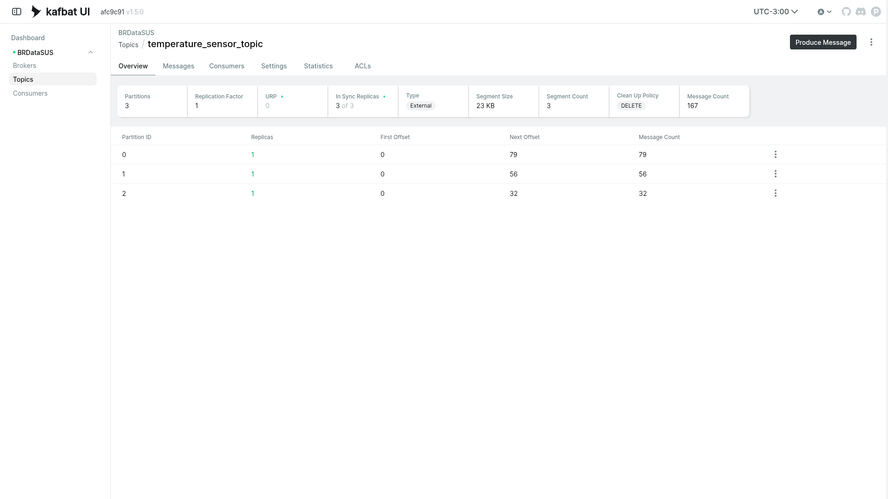

# Apache Kafka — Demo de Sensor de Temperatura

Uma pequena demonstração ponta a ponta (end-to-end) do Apache Kafka construída
com **Docker Compose** e **Node.js**. Um producer IoT simulado publica leituras
de temperatura num tópico do Kafka a cada segundo, um consumer lê essas
mensagens de volta e uma interface web permite inspecionar todo o pipeline em
tempo real.



## Arquitetura

| Serviço     | Imagem                               | Porta | Descrição                                            |
|-------------|--------------------------------------|-------|------------------------------------------------------|
| `zookeeper` | `bitnamilegacy/zookeeper:3.9.3`      | 2181  | Metadados do cluster e coordenação (modo ZooKeeper)  |
| `kafka`     | `bitnamilegacy/kafka:3.5.1`          | 9092  | O broker do Kafka                                    |
| `kafka-ui`  | `kafbat/kafka-ui:latest`             | 8080  | Interface web para monitorar e gerenciar o cluster   |
| `producer`  | Construída a partir de `producer/`   |  -    | Aplicação Node.js que publica leituras do sensor     |
| `consumer`  | Construída a partir de `consumer/`   |  -    | Aplicação Node.js que consome e imprime as mensagens |

Estrutura do projeto:

```
.
├── docker-compose.yaml
├── producer/
│   ├── Dockerfile
│   ├── package.json
│   └── producer.js
├── consumer/
│   ├── Dockerfile
│   ├── package.json
│   └── consumer.js
└── img/
    └── temperature_sensor_topic.png
```

### Como funciona

- **`producer/producer.js`** gera leituras simuladas de sensores IoT
  (`sensor_id`, `temperature`, `timestamp`) usando o
  [Faker](https://fakerjs.dev/), serializa-as em JSON e envia uma mensagem por
  segundo para o tópico `temperature_sensor_topic`. O `sensor_id` é usado como
  chave da mensagem, de modo que leituras do mesmo sensor caem na mesma
  partição.
- **`consumer/consumer.js`** entra no grupo de consumidores
  `temperature_sensor_consumer_group`, se inscreve no tópico desde o início
  (`fromBeginning: true`, o equivalente a `auto_offset_reset='earliest'`),
  desserializa cada mensagem e a imprime.

Ambas as aplicações usam o [KafkaJS](https://kafka.js.org/) para se comunicar
com o broker pelo listener plaintext em `kafka:9092`.

## Primeiros passos

Inicie toda a stack (broker, ZooKeeper, UI, producer e consumer), construindo
primeiro as imagens das aplicações:

```bash
docker compose up --build
```

Adicione `-d` para executar em segundo plano. Quando tudo estiver no ar, você
deve ver o consumer imprimindo mensagens como:

```
Received: { sensor_id: '17', temperature: 23.41, timestamp: '2026-10-23T20:35:59.315Z' }
```

## Kafka UI

O cluster pode ser monitorado pela **Kafka UI**, disponível em
**http://localhost:8080**.

A partir dela você pode:

- Navegar pelo cluster (`BRDataSUS`), brokers e grupos de consumidores.
- Inspecionar o tópico `temperature_sensor_topic`: suas **3 partições**, chaves
  das mensagens, payloads, offsets e throughput.
- **Produzir** mensagens manualmente e **consumi-las** pelo navegador.
- Acompanhar o lag do `temperature_sensor_consumer_group` em tempo real.

## Comandos explicados

### `docker compose up --build`

Inicia todos os serviços definidos no `docker-compose.yaml` e **constrói as
imagens das aplicações antes de iniciá-las**. O flag `--build` é importante: os
Dockerfiles fazem `COPY` dos arquivos de código para a imagem, então depois de
alterar `producer.js`, `consumer.js` ou um `package.json`, as imagens precisam
ser reconstruídas para que as mudanças tenham efeito — sem `--build`, o Compose
reutilizaria a imagem desatualizada de um build anterior.

### `docker compose down`

**Para e remove** todos os containers criados pelo `up`, junto com a rede
padrão. Os dados do Kafka e do ZooKeeper escritos dentro dos containers estão
armazenados nas camadas graváveis dos containers (este projeto não define
volumes nomeados), então o `down` também descarta esse estado — o próximo `up`
começa com um cluster limpo e vazio. Use `docker compose stop` se quiser apenas
pausar os serviços mantendo os dados.

### `docker ps`

Lista os **containers em execução no momento** com seus status e é a maneira
mais rápida de verificar se a stack está saudável — por exemplo, se `kafka`,
`producer` e `consumer` estão `Up` ou saíram com algum código de erro. Adicione
`-a` (`docker ps -a`) para incluir também os containers parados e com falha.

### `docker logs -f producer`

Mostra a **saída de logs do container `producer`** e acompanha ao vivo
(`-f` = follow), transmitindo as novas linhas conforme são produzidas. Aqui você
vê cada leitura do sensor gerada conforme o producer a publica — útil para
confirmar que as mensagens estão sendo enviadas e para identificar erros de
conexão ou travamentos.

### `docker logs -f consumer`

Igual ao anterior, mas para o **container `consumer`**: acompanha os logs para
que você possa ver cada mensagem chegando do tópico em tempo real. Esta é a
verificação ponta a ponta mais simples — se os logs do `producer` mostram
publicações e os logs do `consumer` mostram linhas `Received:` correspondentes,
todo o pipeline está funcionando.

> Dica: `Ctrl+C` interrompe o acompanhamento dos logs; ele não para os containers.

## Fluxo de trabalho típico

```bash
# Construir e iniciar tudo
docker compose up --build

# Verificar se os containers estão em execução (em outro terminal)
docker ps

# Acompanhar cada lado do pipeline
docker logs -f producer
docker logs -f consumer

# Explorar o tópico, as partições e as mensagens no navegador
open http://localhost:8080

# Parar e limpar
docker compose down
```

## Licença

Este projeto está licenciado sob a **GNU General Public License Version 3
(GPL)**. Consulte o arquivo [LICENSE](https://github.com/fmarqueseti/apache-kafka?tab=GPL-3.0-1-ov-file) para mais detalhes.
